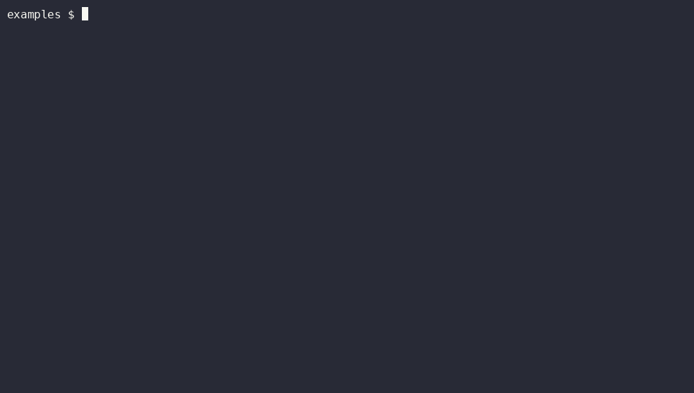

# shape: see the shape of a program

`shape` shows a program as an outline you can read from top to bottom: the states it moves
through, every route from its start to an end, and every way it can go wrong. You do not
have to read the code to follow it.

The states come from a JSON description that the program prints of itself. A file you write
by hand works too.

It is for people who run programs that they did not write line by line, which now includes
anyone whose code is written by an AI.



The recording opens the list of examples, opens `orders.fulfil` and scrolls through its outline.

**What it runs.** `shape` runs the commands listed in the `shape.json` it finds in the
current folder or a folder above it. It runs them on every run, `shape --check` included,
to read the JSON they print. It runs them only when that `shape.json` belongs to you and
nobody else can change it.

**What it does not do.** `shape` changes no file, runs no command that `shape.json` does not
list, and draws no diagram. To read a condition's sentence, it parses a Python file and does
not run it.

<!-- shape coffee --plain -->
```
coffee.machine
Makes one cup of coffee, from the press of the button to the full cup.
7 states, 8 transitions, 2 routes to an end, 2 ways it goes wrong
! marks a state that needs attention

▶ idle · start
      button_pressed → checking_water

  checking_water
      water_found → heating
      tank_empty → no_water !

  heating
      hot → brewing
      heater_error
        ├ if first_failure → heating · restart_heater
        └ otherwise → broken !

  no_water · needs attention
      tank_filled → checking_water

  brewing
      cup_full → served

  served · end · goal

  broken · end · needs attention

Ways it goes wrong (2)
    checking_water   tank_empty     → no_water
    heating          heater_error   → broken

Routes from start to an end (2)
  ends in served
    idle → checking_water → heating → brewing → served
  ends in broken, which needs attention
    idle → checking_water → heating → broken

Goes back (2)
    heating    heater_error if first_failure   → heating
    no_water   tank_filled                     → checking_water

Conditions (1)
    first_failure   The heater has failed once, so it is tried one more time.
```

That is the whole of a small coffee machine, and it is the real output of
`shape coffee --plain`. The `!` marks a state that needs a person's attention, and `goal`
marks the end the program is meant to reach. The word after a dot that follows a target is
an action: what that step does on the way, such as `restart_heater`.

## Try it in one minute

You need Python 3.9 or later. One of the three examples is a JavaScript program and needs
Node.js. Without Node.js, `shape` shows the other two and says that it could not read the third.

```bash
git clone https://github.com/athurdekoos/shape
cd shape
bin/shape
```

A screen opens and stays open, with a list of the example programs. You move with the arrow
keys and press Enter to open one. Esc goes back, `?` explains how to read the outline, and
`q` closes the screen.

To type `shape` from any folder, run `scripts/install.sh` once. It puts one link in
`~/.local/bin` and copies nothing. To remove it, delete that link with `rm ~/.local/bin/shape`.

## Ask an AI to do it

Nobody has to write a table or any JSON by hand. Give a coding assistant this prompt, and it
does the work. This is the short form:

> Read docs/PLUG-IN.md and docs/FORMAT.md in the shape repository. Find the part of my
> program that moves through steps. Show me its states, its events and its conditions, and
> wait for my yes. Then keep those moves in one table that the program runs through, add a
> `--shape` flag that prints the table as JSON, list the program in `shape.json`, and run
> `shape --check` until it reports no problems.

[docs/PROMPTS.md](docs/PROMPTS.md) has the full prompt, a prompt for building a viewer of
your own from nothing, and a prompt for checking that the outline is real.

## How a program is shown

`shape` reads JSON. A move is one line of a table: in this state, on this event, go to that
state. Your program keeps its moves in one table and prints that table as JSON. There are
three ways to get there, and each one is a step up from the one before.

| Way | What you do | What you can trust |
|---|---|---|
| 1. A JSON file | Write the states and events in a JSON file, or have an AI write it from the code. | A first look. The file can drift from the code. |
| 2. A command that prints it | Keep the table in the program and add a flag that prints it as JSON. Any language works. | The outline is as fresh as the code, because it is made again each time. |
| 3. The table is the program | The program takes every move by looking it up in the table. | The outline is what the program does, because there is no second copy. |

Then list the program in a file called `shape.json` at the top of your project:

```json
[
  {"command": ["python3", "orders.py", "--shape"]},
  {"file": "docs/coffee.json"}
]
```

Type `shape` anywhere inside that project and your programs are on the screen. Type
`shape --check` and it tells you, in sentences, what is wrong with the JSON and what you
probably did not mean.

`shape` runs the commands listed in the `shape.json` it finds in the current folder or a
folder above it, on every run, `shape --check` included. List only commands that print the
JSON and do nothing else. Read a `shape.json` you did not write before you type `shape` in
its project.

- [docs/PLUG-IN.md](docs/PLUG-IN.md) walks through all three ways with code.
- [docs/walkthrough/](docs/walkthrough/README.md) shows one small program before it had a
  table and after.
- [docs/FORMAT.md](docs/FORMAT.md) is the format itself, and
  [schema/shape.schema.json](schema/shape.schema.json) is the same format for a tool.
- [examples/](examples/) has one program for each way. There is a JSON file written by hand,
  a Python program and a JavaScript program.
- [python/shapetable.py](python/shapetable.py) is one file a Python program can copy. It
  holds the table, runs the program through it and prints the JSON.

## Use it

| Command | What it does |
|---|---|
| `shape` | Opens the screen on the list of programs. |
| `shape orders` | Opens straight on one program. Part of its name is enough. |
| `shape orders --plain` | Prints the same text and exits. A pipe or an AI agent gets this without asking. |
| `shape orders --plain --all` | Prints every route that was found. Counting stops at 2,000. |
| `shape --check` | Checks the JSON of every program and says what is wrong. |
| `shape --file one.json` | Reads one JSON file. No `shape.json` is needed. |
| `shape --file -` | Reads the JSON from standard input, so a program's output can be piped in. |
| `shape --config path/shape.json` | Uses that list of programs. `SHAPE_CONFIG` in the environment does the same. |

| Key | What it does |
|---|---|
| up, down (or `k`, `j`) | Moves in the list, and scrolls in an outline. |
| Enter | Opens the picked program. |
| space, `b` | Goes a page down, and a page up. |
| `g`, `G` | Goes to the top, and to the bottom. |
| `a` | Shows every route. Press it again to go back to the short lists. |
| Esc | Goes back to the list. |
| `?` | Explains how to read the outline. |
| `q` | Closes the screen. |

When no `shape.json` is found in the folder you are in, or in a folder above it, `shape` shows
its own examples and says so.

## How to read an outline

The states that lead somewhere come first, in the order the program reaches them. The end
states follow: the ones that are fine, then the ones that need attention.

Under the states there are up to five lists.

| List | What it holds |
|---|---|
| Ways it goes wrong | Every move into a state that needs attention, with the event and the condition that cause it. |
| Routes from start to an end | Every way from the start state to an end state that does not visit a state twice. |
| Goes back | Every move that returns to an earlier state, such as a retry. |
| Conditions | Each condition by name, with the sentence written beside it in the program, and the file and line where it is written. |
| Never reached | The states that nothing leads to from the start. The list appears only when there are some. |

The outline also flags two mistakes in a table. A branch that can never be tried, because an
earlier branch has no condition, is marked "never tried". An event whose branches all have
conditions ends with "otherwise no transition is declared".

## What it does not show

- It does not show a program, or a part of one, that has no table. `shape` reads no source
  code to work out what a program does.
- It does not show whether the program follows its table. Only the third way above makes that true, and
  [docs/PLUG-IN.md](docs/PLUG-IN.md) shows a test that keeps it true.
- It does not show an error that the program handles without changing state.
- It does not show steps inside a state, or tables inside tables. The format is flat.
- It does not show where a running program is right now.

## How it is built

| File | What it holds |
|---|---|
| `bin/shape` | The command. |
| `lib/shapeformat.py` | The format, read strictly: the shorthands and the problems. |
| `lib/shapeview.py` | The outline: the model, its lines, the list, the check and the command line. |
| `lib/screen.py` | The screen that stays open, and reading the sources. |
| `python/shapetable.py` | The one file a Python program copies. `shape` itself does not use it. |

It uses the Python standard library only. Run the tests with `python3 -m pytest -q`. Some
tests need Node.js or the `jsonschema` package, and they are skipped when it is missing.

The tests run on Linux and on macOS each time code is pushed. On Linux they also run on
Python 3.9, the oldest version `shape` supports.

It has not been tried on Windows, where Python does not include the `curses` module that the
screen uses.

## Where the idea came from

The idea is ThePrimeagen's. In the video "The Joy of coding is Gone | Prime Reacts", about
nine minutes in, he shows a screen in his editor. It lists each part of his program as an
outline of states. `shape` copies that idea, and it uses none of his code.

The JSON follows the layout that [XState](https://github.com/statelyai/xstate) uses for
states and events. `shape` does not use XState, and it reads only a flat table, not
everything XState can describe.

## Report a problem

Open an issue at [github.com/athurdekoos/shape/issues](https://github.com/athurdekoos/shape/issues).
Say what you typed, what `shape` printed and what you expected. Attach the JSON if you can.

## Status and licence

This is version 0.1. It was built in November 2026, and one person uses it on her own
programs. The format may still change, and [docs/FORMAT.md](docs/FORMAT.md) will say so when it does.

The licence is MIT; see [LICENSE](LICENSE). [CONTRIBUTING.md](CONTRIBUTING.md) says how to
propose a change.
